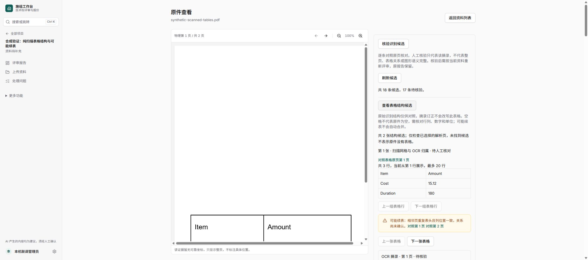
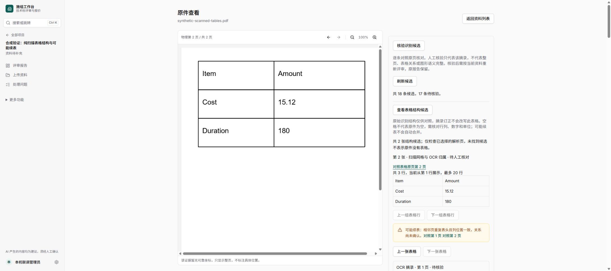

# 内置浏览器恢复与基本交互验证

当前官方应用随附 Browser 插件版本为 `26.1013.40934`，该版本的用户缓存目录缺失，控制连接因 `browser-service.mjs` 不存在而失败。由用户明确要求修复，从应用安装包原样恢复缺失版本的 384 个文件，逐文件 SHA-256 一致；保留旧缓存，不修改配置、浏览器控制代码或安全设置。重新建立控制连接后恢复正常，无需重启应用或业务服务。

使用 Browser 官方控制通道选择 ChatGPT in-app browser，复用已有登录页面和既有合成项目；实际验证展开表格结构、显示两张表候选和可能续表、切换第二张表格、跳转 PDF 物理第 2 页以及保存截图。没有提交核验或修改业务数据。

这证明内置浏览器控制与本页基本查看操作已恢复，不代表全站、所有断点、完整上传／评审／导出的视觉验收。机器摘要见 [receipt.json](receipt.json)。业务部署、自动接续 PAUSED 和 main 保持。
